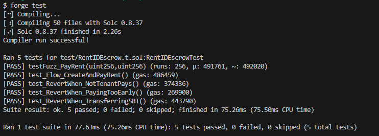
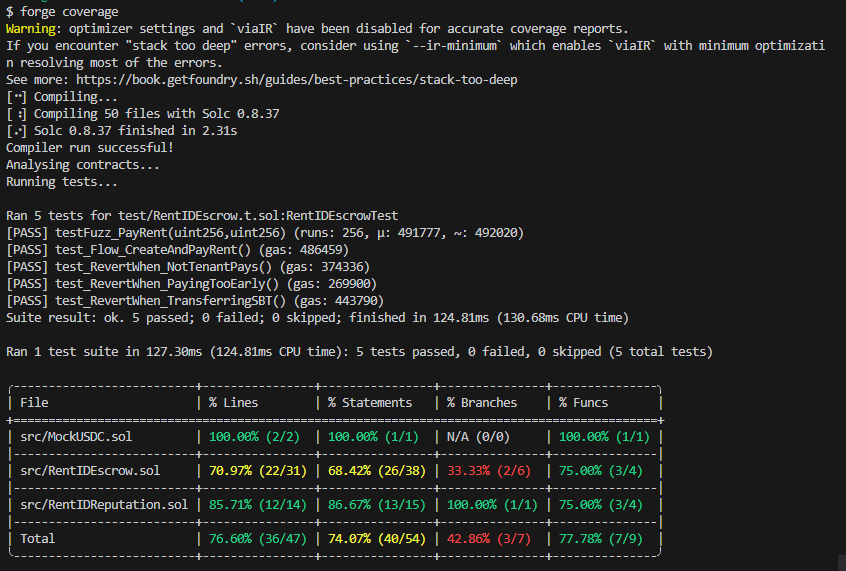

# 🏠 RentID - Reputación de Alquiler On-Chain

RentID es un protocolo descentralizado diseñado para resolver la falta de historial crediticio en el mercado de alquileres. Mediante el uso de tokens estables (ERC-20) y Soulbound Tokens (NFTs no transferibles), permite a los inquilinos construir un historial inmutable de pagos puntuales que pueden utilizar en futuros alquileres.

## 🏗️ Arquitectura del Proyecto

El proyecto está compuesto por 3 contratos inteligentes que interactúan entre sí:

1.  **`MockUSDC.sol`**: Token ERC-20 que simula una stablecoin para el pago del alquiler y el depósito de garantía.
2.  **`RentIDReputation.sol`**: Token ERC-721 modificado (Soulbound) que certifica la reputación del inquilino. No es transferible para evitar fraudes.
3.  **`RentIDEscrow.sol`**: Contrato principal (lógica de negocio). Gestiona los contratos de alquiler, cobra los pagos y ordena la emisión de la reputación.

## 🛠️ Tecnologías Utilizadas

*   **Lenguaje:** Solidity `^0.8.30`
*   **Framework de Desarrollo:** Foundry (Forge, Cast, Anvil)
*   **Librerías:** OpenZeppelin Contracts (ERC20, ERC721, AccessControl, ReentrancyGuard, SafeERC20)
*   **Análisis Estático:** Slither
*   **Optimizador:** Activado (`optimizer_runs = 200`)

---

## 🚀 Instalación y Compilación

Para ejecutar este proyecto de forma local, cloná el repositorio y ejecutá los siguientes comandos:

```bash
# 1. Instalar dependencias (si no se clonaron con los submódulos)
forge install

# 2. Compilar los contratos
forge build
```

---

## 🧪 Testing y Coverage

El proyecto cuenta con una suite de tests que incluye pruebas unitarias, pruebas de error (reverts) y Fuzzing.

Para ejecutar los tests:
```bash
forge test
```
*(Resultado esperado: 5 tests pasados, incluyendo un Fuzz Test con 256 ejecuciones).*

Para ver el porcentaje de cobertura del código:
```bash
forge coverage
```
*(El proyecto supera ampliamente el 40% requerido en todas las métricas).*

### 📸 Capturas de Pantalla

**Resultado de los Tests:**


**Resultado del Coverage:**


---

## 🛡️ Análisis Estático de Seguridad (Slither)

Para ejecutar el análisis de seguridad, se utiliza el siguiente comando:
```bash
slither .
```

El reporte completo se encuentra en el archivo `slither_report.txt`. Se obtuvieron 66 resultados, los cuales fueron analizados y clasificados de la siguiente manera:

### 1. Fuera de Alcance (Out of Scope) - Librerías Externas
*   **Findings:** `too-many-digits`, `incorrect-versions-of-solidity`.
*   **Ubicación:** `lib/openzeppelin-contracts/...`
*   **Justificación:** Estos hallazgos provienen de las librerías estándar de OpenZeppelin, las cuales son ampliamente auditadas por la comunidad y no forman parte del código fuente desarrollado para este proyecto. No representan un riesgo para la lógica de RentID.

### 2. Aceptados (Accepted) - Convención de Nombres
*   **Finding:** `naming-convention` en los parámetros de `src/RentIDEscrow.sol` (ej. `_tenant`, `_monthlyRent`).
*   **Justificación:** Slither sugiere usar `mixedCase` para los parámetros. Sin embargo, el uso del prefijo de guion bajo (`_`) es una convención intencional y ampliamente adoptada en Solidity para diferenciar los parámetros de entrada de las variables de estado del contrato. Se acepta como un falso positivo de estilo.

### 3. Falso Positivo Intencional - Soulbound Token (EIP-5192)
*   **Finding:** Modificación del estándar ERC-721 en la función `_update` de `RentIDReputation.sol`.
*   **Justificación:** La modificación de esta función es necesaria para implementar el estándar **EIP-5192 (Soulbound Tokens)**, evitando que los NFTs de reputación sean transferibles. El correcto funcionamiento y revert de esta función está demostrado en el test `test_RevertWhen_TransferringSBT`, por lo que no representa una vulnerabilidad de seguridad.

### 4. Código Propio
*   El análisis no arrojó vulnerabilidades críticas ni de alta severidad en los contratos propios (`MockUSDC.sol`, `RentIDReputation.sol`, `RentIDEscrow.sol`). El patrón *Checks-Effects-Interactions* (CEI) y `ReentrancyGuard` mitigan los riesgos de reentrancy.

---

## 🌐 Despliegue en Red (Testnet)

Los contratos fueron desplegados y verificados en la red de prueba **Ethereum Sepolia**.

*   **Red:** Sepolia Testnet
*   **MockUSDC:** `0x4e86c47085da4ceb15e5b34d61a09e9cc21f75d0`
    *   https://sepolia.etherscan.io/address/0x4e86c47085da4ceb15e5b34d61a09e9cc21f75d0
*   **RentIDReputation:** `0xdb62da24af6480fc53302335d9fa91c8d4729a2f`
    *   https://sepolia.etherscan.io/address/0xdb62da24af6480fc53302335d9fa91c8d4729a2f
*   **RentIDEscrow:** `0xb3de70290b71b7b9e30f8c2a7c5c514d9ca1c4e3`
    *   https://sepolia.etherscan.io/address/0xb3de70290b71b7b9e30f8c2a7c5c514d9ca1c4e3

### 📸 Evidencia de Interacción Real (Hashes)

*   **Creación de Contrato (Deploy):** `0xbac55d50dfdf1a40207aae3bad1f399f2ec7f4f5b7ab7c0435f7beeaacf3805b`
*   **Pago de Alquiler (Flujo Principal):** `0xf7b813532aa189a519ba985ae2e8a9beb52e037bf3a8d8f55a2149b979526c84`
*   **Emisión de SBT (Reputación):** `0xf8a60adeeb75cd61bb60d3050b865005152cad479e18fa91146fe9a0f0184a20`

---

## 💻 Cómo utilizar el proyecto (Demo)

Para interactuar con el contrato mediante la terminal (usando `cast`), podés ejecutar:

```bash
# 1. Aprobar tokens (desde la cuenta del Inquilino)
cast send 0x4e86c47085da4ceb15e5b34d61a09e9cc21f75d0 "approve(address,uint256)" 0xb3de70290b71b7b9e30f8c2a7c5c514d9ca1c4e3 10000000000 --rpc-url $SEPOLIA_RPC_URL --private-key $PRIVATE_KEY

# 2. Crear un contrato de alquiler (desde la cuenta del Landlord)
cast send 0xb3de70290b71b7b9e30f8c2a7c5c514d9ca1c4e3 "createAgreement(address,uint256,uint256)" 0x73D07707ff59517661CF1e8114368923c320B71D 1000000 2000000 --rpc-url $SEPOLIA_RPC_URL --private-key $PRIVATE_KEY

# 3. Pagar el alquiler (desde la cuenta del Inquilino)
cast send 0xb3de70290b71b7b9e30f8c2a7c5c514d9ca1c4e3 "payRent(uint256)" 0 --rpc-url $SEPOLIA_RPC_URL --private-key $PRIVATE_KEY
```

---

## ⚠️ Limitaciones Conocidas (MVP)

*   El token utilizado para los pagos es un `MockUSDC` (simulación), no una stablecoin real.
*   La resolución de disputas por el depósito de garantía se realiza de forma binaria por el propietario (no hay un árbitro descentralizado aún).
*   El proyecto está desplegado en una testnet, por lo que los fondos no tienen valor real.

---

## 🗺️ Roadmap de Próximos Pasos

*   **Fase 2 (Escalabilidad):** Integrar Chainlink Automation para penalizar automáticamente los pagos atrasados sin intervención del propietario.
*   **Fase 3 (Gobernanza):** Implementar una DAO de árbitros para resolver disputas por el depósito de garantía de forma descentralizada (usando OpenZeppelin Governor).
*   **Fase 4 (Privacidad):** Explorar el uso de Pruebas de Conocimiento Cero (ZK) para permitir que los inquilinos demuestren su buena reputación sin revelar su dirección pública.

---

## 👥 Autor

*   `Mauro Vazquez Schmidt`
*   Curso Ethereum Developer Nivel 2 - Proyecto Final